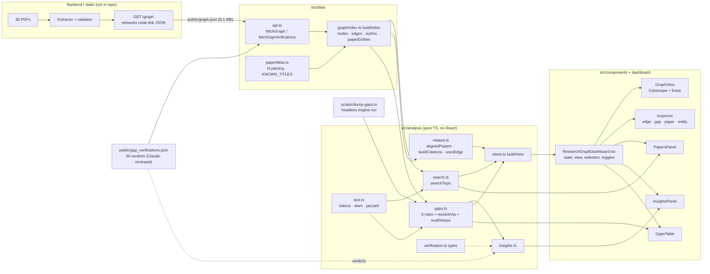

# ResearchGraph: hackathon analysis

*Code review, feature inventory and feature strategy. Analysis only: no application code was changed.*
*Reviewed: the whole repository at commit `438059c`, the data in `public/graph.json` (5.1 MB) and `public/gap_verifications.json`, plus a headless engine run (`npx tsx scripts/dump-gaps.ts`).*

**Label convention.** **[IMPLEMENTED]** means verified in the code. **[PROPOSED]** means an idea in this document that doesn't exist yet.

---

## 0. TL;DR

- **What it is today.** A client-side React/TS/Cytoscape explorer over an extracted knowledge graph of 30 AI-safety papers (scheming, alignment faking, sandbagging). It has five pieces: topic search, an evidence inspector with verified page-cited quotes, a deterministic 6-rule gap engine that suggests resolutions from inside the corpus, reviewer verdicts on all 60 gaps, and an insights panel.
- **Its real strength.** Every edge carries `claim_type` (observed / hypothesized / cited), `negated`, `contexts`, `grounding_review` and verified quotes. **The UI shows these fields but barely reasons over them.** That's the opening.
- **Its biggest accuracy gaps.**
  - There's no entity normalization before reasoning (`gaps.ts:83-110`, used only for resolutions).
  - Negative results are ignored (`gaps.ts:80`).
  - Indirect "review" grounding counts the same as direct quotes (29% of semantic edges).
  - Conflict detection ignores context (`gaps.ts:290-321`).
- **Recommendation: build "Crucible", a claim stress test.** Pick any claim (any of the 551 claim edges) and get a fully cited robustness dossier: support, counter-evidence, context sensitivity, model generality, confounders, what depends on it, and a falsification experiment assembled only from corpus parts. It's deterministic, needs no LLM, and every sentence links to a quote.
- **Best companion (feature #2):** the Gap Confidence Engine, which shares Crucible's entity-clustering core.

---

## 1. Existing architecture

### 1.1 The problem it solves

Literature review across a small, focused corpus is slow and error-prone. ResearchGraph answers four questions from the extracted graph, with page-cited evidence:

1. What does the corpus say about topic X?
2. Which papers are related, and how?
3. Is this specific claim actually supported by a quote, and was it observed or only hypothesized?
4. Where are the gaps, and which method, evaluation or model already in the corpus could close them?

It says explicitly that it sees only the corpus: no outside literature (`gaps.ts:5-9`, `InsightsPanel.tsx:28`).

### 1.2 End to end

1. **Load.** `App.tsx:16-24` calls `fetchGraph()` and `fetchGapVerifications()` in parallel (`data/api.ts:27-34`). The URL comes from `VITE_GRAPH_URL`, then `VITE_API_BASE/graph`, then `/graph.json`. A missing verification file is tolerated.
2. **Index.** `ResearchGraphDashboard.tsx:33` calls `buildIndex(raw)` (`data/graphIndex.ts:62-135`). This step:
   - parses each `evidence_json` string into `Evidence[]` (`graphIndex.ts:23-41`);
   - splits the `"a; b"` paper lists;
   - builds `nodes` (Map), `edges`, the `out`/`inc` adjacency maps, `paperById`, `paperEntities` (paper → entity ids) and `typeCounts`.
3. **Analyse (memoized, once per graph).**
   - `findGaps(ix)`: `gaps.ts:158-324`, capped at 60.
   - `buildCitations(ix)`: `related.ts:87-137`.
   - `computeInsights(ix, gaps, ver)`: `insights.ts:23-67`.
4. **View.** A `View` value (`overview | topic | paper | entity | gap`, `views.ts:11-16`) and the toggles go into `buildView()` (`views.ts:57-202`). That produces a filtered `ViewGraph` (roles, display labels, synthetic Gap nodes, derived edges), so the 1,630 nodes never render at once.
5. **Render.**
   - `GraphView` (Cytoscape + fcose).
   - `Inspector` (right panel, four variants).
   - `PapersPanel` (left panel).
   - `InsightsPanel` (bottom, five columns).
   - `GapsTable`.

All state is held in `ResearchGraphDashboard.tsx:39-45`.

### 1.3 Architecture diagram



### 1.4 Data model: how papers, claims and evidence connect

Verified against `public/graph.json`:

| Element | Count | Notes |
|---|---|---|
| Nodes | 1,630 | Finding 451, Behavior 249, Hypothesis 229, Method 204, Concept 175, AIModel 102, ExperimentalCondition 90, EvaluationMethod 69, Mechanism 31, Paper 30 |
| Links | 2,327 | 680 provenance (`Paper -DOCUMENTS-> Finding/Hypothesis`) and 1,647 semantic |
| Semantic predicates | | INVOLVES 1,096; EXHIBITS 124; INCREASES 103; REDUCES 79; MITIGATES 60; DETECTS 46; MEASURES 43; ENABLES 42; CORRELATES_WITH 27; IS_A 18; OBSERVED_UNDER 9 |
| Claim types | | observed 1,115 · hypothesized 488 · cited 44 |
| Negated | 45 | Negative results, e.g. "adversarial training NOT MITIGATES backdoor behavior" (P03) |
| Grounding | | `direct_quote_grounding` 1,173 · `review` 474 (indirect evidence) |
| Contexts present | 527 of 551 claim (non-INVOLVES) edges | e.g. "sycophancy setting", "o3 and o4-mini across test environments" |
| Claim edges with ≥2 papers | **1 of 551** | Every claim edge is effectively single-paper |

The graph is shaped like this:

```
Paper ──DOCUMENTS──▶ Finding / Hypothesis ──INVOLVES──▶ {Behavior, Method, AIModel, Concept, EvaluationMethod, ...}
AIModel ──EXHIBITS──▶ Behavior          Method ──MITIGATES / REDUCES / DETECTS──▶ Behavior
ExperimentalCondition ──INCREASES / REDUCES──▶ Behavior     X ──IS_A──▶ Y
```

Each edge carries `evidence: Evidence[]`, where each entry has `{paperId, sourcePdf, page, passage, chunkId, validationStatus, context, claimType}` (`types.ts:95-105`). Entity nodes carry `papers[]` and `perPaper` (evidence count per paper, `graphIndex.ts:68-70`). There are **no paper→paper edges**: "aligned" and "mentions" are derived in the frontend. There are **no Gap or Limitation nodes**: gaps are synthetic (`types.ts:91`, `views.ts:36-41`).

**Ignored fields in the data:** `type_votes`, `claim_type_adjusted`, `endpoint_grounding`, `indirect_evidence_count` and `canonical_name`. `grounding_review` is shown as a badge but never used in scoring.

### 1.5 Graph visualization

**[IMPLEMENTED]** in `components/GraphView.tsx`.

- **Setup.** A single Cytoscape instance is created once (`:127-136`). On every `ViewGraph` change, all elements are removed and re-added (`:141-142`), then fcose runs with `randomize: true` (`:144-148`). `fitCapped` clamps the zoom to [0.55, 1.4] (`:110-119`).
- **Encoding.**
  - Colour and shape per type (`theme.ts:5-17`).
  - Size ∝ log(mentions) + paperCount (`:45`).
  - Edge colour and dash follow claim type and edge kind (`:30-38`, `:61`).
  - Gap nodes use a border colour per verdict (`:22-28`, `:110-111`).
- **Interaction.** Tap selects a node or edge. Double-tap re-centres the view (`onOpen`). Selection fades everything except its closed neighbourhood (`:155-166`). Selecting a node that's outside the current view re-centres on it (`ResearchGraphDashboard.tsx:71-77`).
- **Views** (`views.ts`):
  - **overview:** all papers, plus shared entities with paperCount ≥ 2, plus the top 12 gaps (`:93-97`).
  - **topic:** the top 14 entity hits, the top papers, two aligned papers each and four "uses" entities each (`:98-116`).
  - **paper:** up to 30 (or 45) entities, five aligned papers, mention edges and six gaps (`:117-150`).
  - **entity:** 40 one-hop neighbours (`:151-161`).
  - **gap:** focus entities, trigger endpoints and resolutions (`:162-174`).

### 1.6 Topic search and paper ranking

**[IMPLEMENTED]** in `analysis/search.ts:29-67`.

Tokenizing (`text.ts:21-26`) applies a stop-list (`:3-5`, which includes "model", "llm" and "ai") and a crude suffix stemmer (`:8-19`). Each node is scored per query token:

| Where the token matches | Points |
|---|---|
| Label | +3 |
| Alias | +2 |
| First passage or first three evidence passages | +0.5 |

At least half the query tokens must match (`:44`). Then:

- +4 if the label contains the whole phrase;
- ×0.6 for Finding and Hypothesis nodes;
- ×(1 + 0.5·log1p(paperCount)).

**Paper ranking** (`:54-65`) adds up, over the top 60 entity hits, `score × log1p(evidence count in that paper)`. A direct Paper-title hit counts ×3. This is lexical only: no synonyms beyond stemming, no embeddings.

### 1.7 Paper alignment and "mentions"

**[IMPLEMENTED]** in `analysis/related.ts`.

- **`alignedPapers`** (`:36-69`): cosine similarity over shared `SHARED_TYPES` entities with IDF² weights, plus 0.15 if a mention was detected. It returns the shared entities as the explanation.
- **`buildCitations`** (`:87-137`): a regex for `<FirstAuthor> … <Year>` within 40 characters (`:98`), run over every extracted passage and context. Same author and year means the match is flagged *ambiguous*. The engine run shows this: Greenblatt 2024 resolves to three papers (P01, P06, P17).

### 1.8 The six gap rules

**[IMPLEMENTED]** in `analysis/gaps.ts`.

**Key entities** (`:160-162`) are Behavior, Concept or Mechanism nodes with `paperCount ≥ 2` or `mentionCount ≥ 4`. `importance = log1p(mentions) × (1 + 0.5(paperCount−1))` (`:79`). Only non-negated semantic edges count as "live" (`:80`).

| Rule | Code | Fires when | Resolutions |
|---|---|---|---|
| `no-detection` | `:173-184` | A phenomenon (a Behavior, or a Concept with incoming EXHIBITS / INCREASES / ENABLES / REDUCES / MITIGATES) has no live DETECTS or MEASURES edge from a Method or EvaluationMethod | `resolveVia(DETECT)` excluding itself, plus `evalSetups` |
| `no-mitigation` | `:187-201` | A Behavior has no *observed* live MITIGATES or REDUCES edge from a Method. Scored ×0.7 if only hypothesized ones exist | `resolveVia(MITIGATE)` |
| `untested-claim` | `:204-229` | (≥2 hypothesized causal edges with no observed twin **and** observed ≤ half of them) **or** (≥3 Hypothesis nodes involve it, findings ≤ half of that, and observed ≤ 1) | `resolveVia(DETECT)` including itself, plus `evalSetups` |
| `single-source` | `:232-244` | paperCount ≥ 3 but observed non-IS_A edges come from ≤ 1 paper | `evalSetups` |
| `narrow-models` | `:247-286` | Observed AIModel EXHIBITS edges come from one model family (regex, `:58-71`), and near-synonyms (is-a, or name similarity ≥ 0.75) don't add other families | Other-family models that exhibit related behaviours |
| `conflict` | `:290-321` | The same (source, target) pair has a negated and a plain version of the same predicate, or both UP (INCREASES / ENABLES) and DOWN (REDUCES / MITIGATES) | ExperimentalConditions that move the target (candidate moderators) |

**Resolution search.** `related()` (`:83-110`) takes:

| Source of relatedness | Weight |
|---|---|
| The entity itself | 1.2 |
| IS_A neighbours | 1.0 |
| Similar label, Jaccard ≥ 0.34 | 0.5 + 0.5·j |
| Co-INVOLVED in the same Finding or Hypothesis | 0.45 |

`resolveVia` (`:117-139`) scores `w × (observed ? 1 : 0.5) × log1p(evidence+1)` and keeps the top 5. `evalSetups` (`:142-156`) points to papers that already discuss the entity and own an EvaluationMethod.

**Measured output (headless run):** 60 gaps.

| Kind | Count |
|---|---|
| no-detection | 24 |
| no-mitigation | 19 |
| untested-claim | 13 |
| conflict | 2 |
| single-source | 1 |
| narrow-models | 1 |

The cap of 60 at `:323` truncates the list, so lower-scored gaps are dropped silently.

### 1.9 Gap verification and suggestions

**[IMPLEMENTED]**

- **Schema.** `analysis/verification.ts` defines 5 verdicts, keyed by the stable gap ID `kind:entityId`.
- **Coverage.** The JSON covers all 60 current gaps: 0 orphan verdicts and 0 unverified gaps (checked).
- **Breakdown.** 22 confirmed, 20 partly addressed, 8 closed in corpus, 4 extraction artifacts and 6 not supported.
- **Where verdicts appear:**
  - gap node border colours (`GraphView.tsx:22-28`);
  - verdict badges and notes in `Inspector.tsx:114-122`, `GapsTable.tsx:47-49` and `InsightsPanel.tsx:37-42`;
  - `insights.ts:21,24` filters out dismissed verdicts (not-supported, closed, artifact) for "Underexplored" and "Directions".
- **"Suggested directions"** (`insights.ts:53-65`) uses the first *observed* resolution per surviving gap and turns it into "Hypothesis: apply M (Pxx) to X".
- ⚠ **Provenance of the verdicts.** The file's `method` field says they were *"Reviewed by Claude (Opus 5.5) … graph evidence passages plus prior knowledge of the papers. PDFs not re-read."* They're useful labels, but they are **LLM judgments, not human ground truth**. Any precision figure computed against them needs to say so.

### 1.10 Status of each capability

| Capability | Status | Evidence |
|---|---|---|
| Graph loading (static or backend), retry UI | ✅ Full | `App.tsx`, `api.ts` |
| Index, adjacency, evidence parsing | ✅ Full | `graphIndex.ts` |
| Filtered graph views (5 modes), type chips, findings and gaps toggles | ✅ Full | `views.ts`, `ResearchGraphDashboard.tsx:138-155` |
| Evidence inspector (quotes, page, verified / fuzzy, claim type, contexts) | ✅ Full | `Inspector.tsx:25-55, 82-102` |
| Topic search and paper ranking | ✅ Full (lexical only) | `search.ts` |
| Aligned papers (explainable) | ✅ Full | `related.ts:36-69` |
| In-corpus citations | 🟡 Partial: regex over passages, sparse, ambiguous | `related.ts:87-137` |
| Gap engine (6 rules plus resolutions) | 🟡 Works; ~30% false positives by its own verification | `gaps.ts`, `GAP_VERIFICATION.md` |
| Verdict display | ✅ Full | above |
| Verdict *editing* in the UI | ❌ Missing (static JSON) | `HANDOFF.md` TODO 5 |
| Research insights panel | ✅ Full (heuristic) | `insights.ts` |
| Entity normalization / synonym merge | ❌ Missing (used only inside resolutions and narrow-models) | `gaps.ts:83-110, 252-259` |
| Context-aware reasoning | ❌ Missing (contexts are only displayed) | `Inspector.tsx:96` |
| Use of negated edges as evidence | ❌ Missing outside conflict detection and red colouring | `gaps.ts:80` |
| Multi-hop / path reasoning | ❌ Missing (only 1-hop entity view) | `views.ts:151-161` |
| Opening the PDF at the cited page | ❌ Missing (page shown, no link) | `Inspector.tsx:37-38` |
| Export, permalinks or shareable view state | ❌ Missing | — |
| Tests | ❌ None (no test runner; `dump-gaps.ts` is the only harness) | `package.json` |
| "Multi-Agent" (subtitle) | ❌ Not in this repo; all analysis is deterministic client code | `ResearchGraphDashboard.tsx:106` |

---

## 2. Verified feature inventory

| # | Feature | Files | How it's implemented | What works | Limits / possible errors |
|---|---|---|---|---|---|
| F1 | Graph loading | `App.tsx`, `data/api.ts` | `fetch` + env URL, loading / error / retry states | Static or backend source; a missing verdict file is OK | Fetches and parses 5.1 MB in one go; evidence is JSON nested in JSON, parsed for every entry |
| F2 | Graph index | `data/graphIndex.ts` | Maps plus adjacency, built once | Clean and pure; reusable in Node (`dump-gaps.ts`) | Drops links with unknown endpoints silently (`:94`); ignores `type_votes`, `claim_type_adjusted` |
| F3 | Paper metadata | `data/paperMeta.ts` | Regex on `paper_id`, plus a hardcoded 35-title table | Readable labels like "P01 · Greenblatt 2024"; missing-paper warning | Specific to this corpus (`KNOWN_TITLES`, hardcoded alias at `:48-50, 77-82`) |
| F4 | Topic search | `analysis/search.ts`, `PapersPanel.tsx` | Token overlap with label > alias > passage weights | Fast, explainable "via" entities | No synonyms ("CoT" ≠ "chain-of-thought"); stop-list removes "model", so "model organism" queries degrade; `searchTopic` runs twice per topic view (`PapersPanel.tsx:20`, `views.ts:99`) |
| F5 | Paper alignment | `analysis/related.ts:36-69` | IDF cosine over shared entities | Explanations (shared entities) shown | Recomputes every paper's `norm` on each call (O(P²)); alignment is inflated by normalization splits |
| F6 | Mentions / citations | `analysis/related.ts:87-137` | Author+year regex over passages | Ambiguity is flagged honestly | Only 6 papers have any detected outgoing mention; can't target author-less IDs (2026 preprints) |
| F7 | Graph exploration | `views.ts`, `GraphView.tsx` | Role-based subgraph, fcose layout | Readable focused views, neighbourhood highlight, double-click drill-down | Layout re-randomized on every change, including toggles, so the mental map is lost; no path or compare mode; no history/back stack beyond the "Overview" crumb |
| F8 | Evidence inspector | `Inspector.tsx` | Four variants; `EvidenceList` hides unverified quotes | Best feature: verified quotes, page, claim type, contexts, negation | Treats a missing `validationStatus` as OK (`:26`); `review` (indirect) grounding is only a badge; no cross-paper view of "all claims about X→Y" |
| F9 | Gap engine | `analysis/gaps.ts` | Six deterministic rules plus corpus-only resolution search | Fully explainable; stable IDs; the headless dump allows review | See §3.1: no synonym merge, negated edges ignored, context-blind conflicts, metrics treated as phenomena, cap of 60 |
| F10 | Gap verification | `verification.ts`, `public/gap_verifications.json` | Static verdict map keyed by gap ID | Badges everywhere; dismissed gaps filtered from insights | LLM-produced; read-only; no record of which engine version produced each gap |
| F11 | Research insights | `analysis/insights.ts`, `InsightsPanel.tsx` | Top-k lists | Every card is clickable and has refs | "Conflicts" uses `allGaps` (not verdict-filtered), so the two known false conflicts are still shown (`insights.ts:44-46`) |
| F12 | Gaps table | `GapsTable.tsx` | Filter by kind and verdict | Quick triage | No sort, no confidence column |
| F13 | Headless gap dump | `scripts/dump-gaps.ts` | Runs the engine in Node via `tsx` | Reproducible; also prints the citation graph | No assertions; not a test |

---

## 3. Code-level limitations

### 3.1 Accuracy

1. **No entity normalization before rules run.** This is the cause of most false positives. `related()` (`gaps.ts:83-110`) knows about similar names but only feeds resolutions and narrow-models. The threshold also misses abbreviations: `jaccard({cot, monitor}, {chain, thought, monitor}) = 0.25 < 0.34`. As a result, "CoT monitor", "CoT monitoring", "chain-of-thought monitoring" and "CoT monitoring module" are four separate nodes, each with a fraction of the evidence. Other splits: deception / deceptive behavior / strategic deception; scheming / covert actions; backdoor behavior / backdoored behavior / backdoored defection (P03).
2. **Negative results are thrown away.** `live = semantic && !negated` (`gaps.ts:80`). There are 45 negated edges, almost all "X does NOT mitigate / detect Y", for example:
   - five adversarial-training and RL methods that fail to remove backdoors (P03);
   - "chain-of-thought monitoring NOT DETECTS alignment faking" (P29);
   - "black-box transcript analysis NOT DETECTS sandbagging" (P24).

   These are the strongest evidence that a gap is real ("tried and failed"), but `no-mitigation` and `no-detection` can't see them. Gap descriptions say "no method" when the corpus actually says "methods tried and failed", which is a materially different claim.
3. **Indirect evidence counts as much as direct quotes.** 474 of 1,647 semantic edges have `grounding_review = "review"` (`indirect_evidence_count > 0`). No scoring path in `gaps.ts`, `search.ts` or `insights.ts` down-weights them.
4. **Conflict detection is context-blind** (`gaps.ts:297-321`). Both detected conflicts were judged "not supported" because the edges' `contexts` explain them (the sycophancy setting; ChatGPT vs GPT-4). Separately, a real pattern goes unnamed: "anti-scheming training REDUCES covert actions" next to "anti-scheming training NOT MITIGATES covert actions" (P07, context "does not eliminate"). That is a **partial effect**, a distinct and useful category. The engine treats it as neither a conflict nor a partial effect.
5. **Metrics are typed as phenomena.** "compliance gap" and "covert action rate" trigger `no-detection` (`gaps.ts:173-176`) even though they're measurements.
6. **`untested-claim` counts negated edges as hypotheses** (`hyp` at `:204` doesn't filter on `live`).
7. **Cross-paper corroboration is invisible.** 550 of 551 claim edges have one paper. Any "replicated by N papers" logic must cluster edges first. `single-source` partly works around this through node-level `papers`.
8. **The model-family regex is coarse** (`gaps.ts:58-67`). `/llama|meta/` and the generic "models", "frontier models" and "reward-hacking model" all fall into "Other / unspecified", which excludes them from narrow-models.
9. **Citation detection is sparse and ambiguous**: three-way Greenblatt 2024 ambiguity (`related.ts:120-123`).
10. **Missing corpus papers (#11–#15)** bias gaps around sycophancy, sabotage and situational awareness. The UI warns about this (`PapersPanel.tsx:79-83`).
11. **The verdict "ground truth" is LLM-generated** (see §1.9).

### 3.2 Architecture

- `ResearchGraphDashboard.tsx` holds all the state; there's no URL state, so views can't be shared or bookmarked.
- The `Gap` objects carry no engine version, and the verdicts carry no engine hash.
- Corpus-specific constants (`KNOWN_TITLES`, `EXAMPLES`, `MODEL_FAMILIES`, aliases) are mixed into generic modules.
- There are no tests, so any engine change can silently shift gap IDs, and verdicts then disappear without warning.

### 3.3 Performance (fine at 1.6k nodes; it would break around 10–50k)

| Hotspot | Location | Complexity |
|---|---|---|
| `related()` loops over all nodes for each key entity, and is called twice for each Behavior | `gaps.ts:95-99`, `:252` | O(K·N) |
| `alignedPapers` recomputes `norm(p)` for every candidate paper on every call (Inspector plus views) | `related.ts:38-45` | O(P²·E_p) |
| `buildCitations` runs every evidence passage against every target regex | `related.ts:117-118` | O(Evidence·P) |
| `ix.edges.find` for each trigger, and `gaps.find` for each displayed gap node | `views.ts:167, 197`; `Inspector.tsx:108` | O(E) per trigger, O(G·V) |
| Full Cytoscape teardown plus randomized fcose re-layout on every toggle | `GraphView.tsx:141-148` | — |
| 836 kB bundle (cytoscape) loaded eagerly | `HANDOFF.md` | — |

---

## 4. Ten proposed features (all [PROPOSED])

Each proposal builds on capabilities that are actually in the code, and none duplicates an existing feature.

### P1. Crucible: claim stress test and falsification ⭐
Choose any claim edge (or "X → Y" pair). Crucible builds a **robustness dossier** with seven checks:

1. **Support:** independent papers, observed vs cited vs hypothesized, direct vs indirect grounding.
2. **Counter-evidence:** negated or opposite-direction edges across the *entity clusters* of both endpoints.
3. **Context sensitivity:** whether support and counter-evidence come from different settings (via `contexts`).
4. **Model generality:** model families covered, including explicit negatives such as "GPT-4o NOT EXHIBITS alignment faking".
5. **Confounders:** other conditions or mechanisms that move the same target.
6. **Dependents:** what depends on this claim (hypotheses that involve both endpoints, gap resolutions that cite it).
7. **Falsification card:** a concrete experiment whose model, evaluation and condition slots are each filled by a cited corpus edge, or left empty with "no corpus support".

This merges your Falsification Mode, Stress Test and a lite What-If into one cohesive feature.

### P2. Gap Confidence Engine with a precision scoreboard
Run the gap rules over **entity clusters** instead of raw nodes. Add a context check for conflicts, a metric-label filter, negated edges as "tried and failed" evidence, and down-weighting for indirect evidence. Each gap gets a **confidence breakdown** (why it's credible) instead of one score. A scoreboard measures rule precision against the 60 verdicts, before and after. Because the verdicts informed the fixes, it should report a held-out split and say clearly that the verdicts are LLM-generated.

### P3. Negative Results Ledger ("What didn't work")
A first-class view of the 45 negated claims, grouped by target behaviour. For example, *backdoor behavior: SFT ✗, adversarial training ✗, RL ✗, HHH RL ✗ (P03)*. Each row carries its quote and context. Negative results are rarely surfaced by literature tools, and here they're already in the data, just unused.

### P4. Retraction / What-If simulator
"What if paper P07 were wrong, or a given claim were removed?" `buildIndex` and `findGaps` are pure, so filter the raw graph, re-run the engine and **diff**: gaps that reopen, resolutions that disappear, alignment changes. Ranking every paper by how many conclusions it carries gives "**load-bearing papers**". The UI states clearly that the results are hypothetical.

### P5. Hypothesis → Evidence Timeline
Using `paperMeta.year` and clustering, track claims that were **hypothesized in earlier papers and observed later**. For example, deceptive alignment hypothesized by Hubinger 2019 (P04) and Carlsmith 2023 (P05), then demonstrated with model organisms in 2024 (P01, P03). It also shows which claims are *still* only hypothesized. This turns the corpus into a picture of how the field has progressed.

### P6. Missing Experiment Composer (for gaps)
For a confirmed gap, assemble an experiment card from corpus parts:

- a model family that exhibits related behaviour;
- an EvaluationMethod that MEASURES or DETECTS a cluster neighbour;
- a condition that INCREASES the behaviour, to create pressure;
- a baseline from the closest paper.

Each slot links to an edge. This is the deterministic version of "generate an experiment". (It's also a sub-component of P1.)

### P7. Context Lens: where does the effect hold?
Parse the free-text `contexts` (527 claim edges) into facets with regexes: model, setting, training stage, and any percentage it contains. Then show a **claim × context matrix**: for alignment faking, rows are settings (helpful-only, animal welfare, sycophancy), columns are models, and cells are observed, negated or absent.

### P8. Evidence Chain Explorer
A k-shortest-paths search over typed semantic edges (and through Finding nodes via INVOLVES). Example query: "how does RL training relate to evaluation awareness?" Every hop shows its quote, and paths that cross a hypothesized edge are marked as a weak link. Feasible, but the graph's claim edges are star-shaped around Findings, so many interesting paths pass through INVOLVES hops, which are semantically weak. Medium risk of plausible-looking but meaningless chains.

### P9. Safety Case Builder (domain flagship)
Inspired by P26 (evaluations-based safety cases): pick a threat such as scheming. A goal-structuring tree is generated from a template (detect, mitigate, control for evaluation awareness, cover model families). Each leaf is filled with corpus evidence or turns red as a gap. Very compelling for AI-safety judges, but template-heavy and specific to this domain.

### P10. Ingestion Impact Forecast
"Which paper should we add next?" Rank the missing curated papers (#11–#15) and candidate titles by token overlap with the entities of open gaps, using the `missing:NN` references already present in verdicts. Shows which papers would most likely close gaps. Cheap, and it frames the tool as a guide for building the corpus.

*Considered and rejected:* a chatbot, PDF summarization, embeddings search and a verdict editor. The editor is useful hygiene, but not distinctive.

---

## 5. Ranked implementation matrix

Scores run from 1 to 5, where 5 is best. **Halluc. safety** = low risk of misleading output. Effort assumes one developer with Claude Code.

| Rank | Feature | Original | Feasible | Demo impact | Reuse | Reliable | Research use | Halluc. safety | Effort |
|---|---|---|---|---|---|---|---|---|---|
| **1** | **P1 Crucible** | 5 | 4 | 5 | 4 | 4 | 5 | 5 | **~6 h** |
| 2 | P2 Gap Confidence + scoreboard | 3 | 5 | 4 | 5 | 4 | 5 | 5 | ~3 h |
| 3 | P4 Retraction / what-if simulator | 5 | 4 | 5 | 5 | 3 | 4 | 4 | ~3–4 h |
| 4 | P3 Negative Results Ledger | 4 | 5 | 4 | 5 | 5 | 4 | 5 | **~1 h** |
| 5 | P5 Hypothesis → Evidence Timeline | 5 | 3 | 4 | 3 | 3 | 4 | 3 | ~4 h |
| 6 | P9 Safety Case Builder | 5 | 3 | 5 | 3 | 3 | 4 | 3 | ~6–8 h |
| 7 | P7 Context Lens | 4 | 3 | 4 | 3 | 3 | 4 | 3 | ~4 h |
| 8 | P6 Missing Experiment Composer | 3 | 4 | 3 | 5 | 4 | 4 | 4 | ~2 h (free inside P1) |
| 9 | P8 Evidence Chain Explorer | 3 | 3 | 4 | 3 | 2 | 3 | 2 | ~4–5 h |
| 10 | P10 Ingestion Impact Forecast | 3 | 5 | 2 | 4 | 3 | 3 | 4 | ~1–2 h |

**Best by time budget**

- **1-hour improvement: P3 Negative Results Ledger.** Add a sixth InsightsPanel column, or a toggle on the gaps table, built from `ix.edges.filter(e => e.negated)`. It's visible, novel and uses ignored data. Optionally, add a line to `no-mitigation` and `no-detection` gap descriptions: "tried and failed: …". *(Runner-up for 1 h: a context check in conflicts, which removes both known false conflicts.)*
- **3-hour feature: P2 Gap Confidence Engine with a before/after precision scoreboard.** It gives judges a quantitative story ("we audited our own AI and fixed it"). *(Close second: P4, which reuses the pure engine almost for free.)*
- **6-hour flagship: P1 Crucible.**

**Recommended combination (two features at most):** **Crucible + Gap Confidence Engine.** They share one new module, `entityClusters.ts`, so the 3-hour feature is largely a by-product of the flagship's first step. Crucible stress-tests *claims*; the Confidence Engine stress-tests *gaps*. The pitch is one coherent idea: **"ResearchGraph argues against itself."**

---

## 6. Top recommendation: Crucible

### 6.1 Why Crucible

- **It works on all 551 claims**, not just 60 gaps, so judges can pick any claim live and it still works.
- **It's deterministic and fully cited.** Every sentence is generated from a template whose slots are edge or node IDs that open in the existing evidence inspector. There's no LLM and no API cost.
- **It's an anti-hallucination tool,** which is the opposite of what most hackathon AI demos are. That's memorable to sceptical judges.
- **It uses rich data the app currently ignores:** negation, contexts, grounding, model families and claim types.
- **The real data has strong punchlines.** All three cases below were verified in `graph.json`.

### 6.2 User workflow

1. Click any relationship in the graph, or any outgoing or incoming row in the entity inspector. A new **"⚗ Stress-test this claim"** button appears (`Inspector.tsx` edge variant, `:82-102`).
2. The view switches to `{ mode: 'claim', edgeId }`. The graph shows:
   - the claim in the centre;
   - **support** edges in green;
   - **challenge** edges in red;
   - **qualifier** edges (partial effect or different context) in amber;
   - **confounders** in yellow;
   - **dependents** in purple.
   Clusters are drawn as compound parent nodes, for example "CoT monitoring (4 aliases)".
3. The right panel shows the **Crucible report**:
   - a band: *Robust / Qualified / Contested / Speculative*;
   - a seven-row checklist (✓ / ⚠ / ✗), each row expandable to its quotes;
   - the **falsification card**.
4. Every item is clickable, which jumps to the existing evidence view.
5. A **"Show what depends on this"** toggle (the lite what-if) highlights the hypotheses and gap resolutions that would lose support if the claim fell. It's labelled *hypothetical*.

### 6.3 Demo cases from the existing graph (verified)

**A. "chain-of-thought monitoring DETECTS alignment faking"**

- **Cluster:** CoT monitor, CoT monitoring, chain-of-thought monitoring and CoT monitoring module. These are four nodes today, and only an abbreviation map can merge them.
- **Support:**
  - P27 "chain-of-thought monitoring DETECTS faking intent" (observed);
  - P27 "CoT monitoring module MEASURES recognition of being evaluated" (observed; *"95% accuracy on 400 test instances"*);
  - P16 "CoT monitor DETECTS alignment faking" (**hypothesized**).
- **Challenge:** P29 "chain-of-thought monitoring **NOT** DETECTS alignment faking", context *"strategic compliance not verbalized"*.
- **Qualifiers:**
  - P20 "CoT monitoring CORRELATES_WITH Imperfect oversight method";
  - P07 "CoT-action mismatch OBSERVED_UNDER after anti-scheming training".
- **Band:** Contested. The detection evidence is for *verbalized* faking, and the counter-evidence is about *unverbalized* compliance.
- **Falsification card:** run P29's value-conflict diagnostic (VLAF) on models where P27's CoT monitor fires, and measure the compliance gap among transcripts the monitor flagged as clean.

**B. "Claude 3 Opus EXHIBITS alignment faking"**

- **Support:** P01 (observed, helpful-only and animal-welfare settings).
- **Counter:** P01 "Claude 3 Opus NOT EXHIBITS alignment faking" (context *"sycophancy setting"*). The contexts don't overlap, so it's classified **context-dependent**, not contradicted. That's exactly the false conflict the current engine reports and the verification rejected.
- **Generality:**
  - exhibits: Claude 3 Opus, Claude 3.5 Sonnet, Llama-3.1-405B and Llama-3.1-70B (P31), olmo2-7b (P29);
  - doesn't exhibit: Claude 3 Haiku, GPT-4o, claude-sonnet-4.6.
  - So it's model-dependent, with a scale signal.
- **Band:** Qualified.

**C. "anti-scheming training REDUCES covert actions" (P07)**

- **Qualifier:** "anti-scheming training NOT MITIGATES covert actions" (*"does not eliminate; 4 of 26 evaluations remain"*). This is a **partial effect**, not a contradiction.
- **Confounder:** "anti-scheming training INCREASES verbalized evaluation awareness" (*"o4-mini 0.9%→5.5%"*). So part of the reduction may come from evaluation awareness rather than real alignment, which matches the reviewer note in `GAP_VERIFICATION.md`.
- **Generality:** OpenAI models only (o3, o4-mini), so the card proposes a non-OpenAI model drawn from the corpus.
- **Band:** Qualified.

### 6.4 Reuse

| Existing piece | Reused for |
|---|---|
| `GraphIndex` (`out`/`inc`, `perPaper`, evidence) | All lookups |
| `related()` logic and `modelFamily()` (`gaps.ts:58-110`) | Becomes the seed of `entityClusters.ts`; `modelFamily` is already exported |
| `EvidenceList`, `nodeLink`, `paperLink` (`Inspector.tsx`) | Every check row renders quotes the same way |
| `buildView` role system and `GraphView` role styles | New roles: support, challenge, qualifier, confounder, dependent |
| `Gap.resolutions[].edgeId` | Dependents ("this claim supports gap resolution …") |
| `evalSetups()` pattern | Falsification-card evaluation slot |
| `scripts/dump-gaps.ts` pattern | `scripts/dump-crucible.ts` for headless tests |

### 6.5 Files to change

| File | Change |
|---|---|
| **new** `src/analysis/entityClusters.ts` | `buildClusters(ix)` returns `Map<nodeId, ClusterId>` plus members and reasons. Inputs: IS_A, aliases, an abbreviation map (CoT→chain of thought, RL→reinforcement learning, SFT, RLHF, HHH), stemmed-label containment, and Jaccard ≥ θ within compatible types only |
| **new** `src/analysis/stressTest.ts` | `stressTest(ix, clusters, gaps, edgeId): CrucibleReport` (pure) |
| **new** `src/components/CruciblePanel.tsx` | Report UI: band, checklist, falsification card, dependents toggle |
| `src/analysis/views.ts` | Add `{mode:'claim'; edgeId}` to `View`, new `Role`s and a `claim` branch in `buildView` |
| `src/components/Inspector.tsx` | "Stress-test" button on edge variant and on entity relation rows; render `CruciblePanel` in claim mode |
| `src/components/GraphView.tsx`, `src/theme.ts`, `src/index.css` | Role styles and colours, optional compound cluster nodes, legend entries |
| `src/ResearchGraphDashboard.tsx` | Memoize `clusters`, add crumbs for claim mode, handle `go()` |
| **new** `scripts/dump-crucible.ts` | Headless run plus `node:assert` golden tests (no new dependencies) |
| *(P2, later)* `src/analysis/gaps.ts` | Consume `clusters`; context check; metric filter; negated evidence; `confidence` breakdown |

**No backend, LLM, database or model downloads are required.** An optional later step could add one LLM call to paraphrase the card into prose. Don't do that for the demo: the deterministic version is the pitch.

### 6.6 Algorithms and data structures

```ts
type Polarity = '+' | '-';
type Family = 'EFFECT' | 'DETECT' | 'EXHIBIT' | 'CORREL' | 'ISA' | 'COND';
// EFFECT: INCREASES/ENABLES = +, REDUCES/MITIGATES = −  (sign flips if negated)
// DETECT: DETECTS/MEASURES; EXHIBIT: EXHIBITS; ... negated => '-'

interface Stance { edge: GEdge; relation: 'support'|'challenge'|'qualifier'; why: string; weight: number }
interface Check  { id: CheckId; status: 'pass'|'warn'|'fail'|'na'; summary: string; refs: string[] /* edge/node ids, never empty unless status 'na' */ }
interface CrucibleReport { claim: GEdge; srcCluster: Cluster; tgtCluster: Cluster;
  stances: Stance[]; checks: Check[]; band: 'Robust'|'Qualified'|'Contested'|'Speculative';
  falsification: { slots: Record<'model'|'evaluation'|'condition'|'baseline', {nodeId: string|null; ref: string|null}>; prediction: string } ;
  dependents: { hypotheses: string[]; gapResolutions: {gapId: string; edgeId: string}[] } }
```

1. **Clustering** (precomputed once). Union-find over nodes of compatible type groups:
   - phenomena: {Behavior, Concept, Mechanism};
   - interventions: {Method, EvaluationMethod};
   - {AIModel};
   - {ExperimentalCondition}.

   Union when any of these holds:
   - an IS_A edge;
   - shared alias;
   - abbreviation-expanded token Jaccard ≥ 0.6;
   - one stemmed label contained in the other with length ratio ≥ 0.5.

   Never union across type groups. Store the reason for every union, because the UI shows it ("merged because: abbreviation CoT").

   Cost: about 1,630² / 2 ≈ 1.3M Jaccard comparisons per group in the worst case, well under 200 ms. It runs in `useMemo`.
2. **Candidate edges.** All semantic, non-INVOLVES edges with source ∈ C(s) and target ∈ C(t), using `ix.out` on cluster members: O(Σ deg).
3. **Stance classification.**
   - Same family and same polarity → **support**.
   - Opposite polarity → **challenge**, unless a qualifier rule applies:
     - **partial effect:** EFFECT(+, REDUCES) together with negated MITIGATES → qualifier;
     - **context split:** the stemmed-token Jaccard of the two edges' `contexts` and evidence contexts is < 0.15 and both are non-empty → qualifier, "different setting".
   - Hypothesized or cited supporting edges get weight 0.5 / 0.3. `grounding = 'review'` gives ×0.7.
4. **Checks:**

   | Check | Rule |
   |---|---|
   | (a) Independent support | Number of distinct papers with *observed* support. Cited edges don't count as independent |
   | (b) Counter-evidence | Challenges after the qualifier rules are applied |
   | (c) Context dependence | Any context-split qualifiers |
   | (d) Model generality | `modelFamily` over EXHIBITS edges, positive and negated, into C(t), when the claim is about a behaviour |
   | (e) Confounders | Other EFFECT edges into C(t) from ExperimentalCondition or Mechanism, plus effects of s on *other* targets that could themselves move t (one hop) |
   | (f) Evidence quality | Share of verified vs fuzzy quotes, direct vs review grounding |
   | (g) Dependents | Hypothesis nodes that INVOLVE members of both C(s) and C(t); gaps whose `resolutions[].edgeId` ∈ the claim's cluster edges |

5. **Band** (transparent rules, shown in the UI):

   | Band | Condition |
   |---|---|
   | Speculative | No observed support |
   | Contested | ≥1 unexplained challenge |
   | Qualified | Only qualifiers, or narrow generality, or a single paper |
   | Robust | ≥2 independent observed papers, no challenge, ≥2 model families |

6. **Falsification card.** Target the weakest check:
   - **Generality:** pick a corpus AIModel of a different family that EXHIBITS a related behaviour.
   - **Context:** pick the challenging context as the condition to vary.
   - **Confounder:** pick the confounding condition and propose holding it fixed.

   The evaluation is an EvaluationMethod that MEASURES or DETECTS a C(t) member (or `evalSetups` fallback). The prediction is a template: "If the claim holds, expect ⟨outcome⟩ under ⟨condition⟩ in ⟨model⟩; observing ⟨negation⟩ would falsify it." **An empty slot shows "No corpus support". It is never filled by invention.**

### 6.7 How grounding is enforced

- **Type-level:** `Check.refs` must be non-empty for any status other than `na`. A dev-mode assertion in `stressTest.ts` and a test over all 551 claims both check this.
- Every sentence is template-generated from slots that hold IDs. No free text comes from anywhere except graph labels, quotes and contexts.
- Only `verified` / `fuzzy_verified` quotes count as support. Indirect (`review`) evidence is labelled "indirect" in the UI and down-weighted.
- Hypothetical content (dependents / what-if, the falsification card) uses a distinct visual treatment (dashed purple, "HYPOTHETICAL" chip). It's never mixed with established findings.
- Cluster merges show their reason and can be undone per member ("treat separately"), which makes normalization auditable.
- The footer of every report reads: *"Corpus: 30 papers; #11–#15 missing; conclusions limited to extracted evidence."*

### 6.8 Failure cases and mitigations

| Failure | Example | Mitigation |
|---|---|---|
| Over-merging | "deception" vs "deception performance"; "misalignment" vs "misaligned generalization" | Type-group restriction, length-ratio guard, visible reasons, per-member undo |
| Under-merging | Abbreviations not in the map; paraphrases ("scheming" vs "covert actions") | Curated abbreviation map plus IS_A; show "possible related: …" (Jaccard 0.34–0.6) without merging |
| Empty contexts | 24 claim edges have none | Context check returns "unknown", never "split" |
| Cited edges counted as replication | P29 citing Greenblatt 2024 | Cited edges excluded from independence; detect the `et al.` pattern in contexts |
| Single-paper data | 550 of 551 edges | Independence comes from clusters; the report is honest when only one paper exists |
| Hypothesis vs finding confusion | INVOLVES hops | Dependents use only Hypothesis nodes; labelled hypothetical |
| Missing papers | Sycophancy, sabotage, situational awareness | Warning chip when the claim's entities overlap `missingCorpusRanks()` titles |
| Polarity of negated claims | Stress-testing "adversarial training NOT MITIGATES backdoor" | Polarity is computed after negation; support means agreeing negatives |

### 6.9 Testing strategy (no new dependencies)

1. **Golden tests** in `scripts/dump-crucible.ts` with `node:assert`, run via `npx tsx`:
   - Case A: the CoT cluster contains ≥3 members, there's ≥1 challenge from P29, and the band is Contested.
   - Case B: the sycophancy edge is classified `qualifier: context`, not a challenge.
   - Case C: the "NOT MITIGATES" edge is classified `qualifier: partial`; the confounder list includes "verbalized evaluation awareness"; generality fails as single-family.
2. **Invariants over all 551 claim edges:**
   - no throws;
   - every non-`na` check has refs, and every ref resolves in `ix`;
   - the claim itself appears in support;
   - total runtime is under 1 s.
3. **Cluster sanity:** print the top 30 clusters by size for manual review; assert that no cluster crosses type groups.
4. **Regression:** re-run `dump-gaps.ts` and diff gap IDs. They must be unchanged until P2 deliberately changes them.
5. **Manual:** `npm run build`, then walk the three demo cases in the browser.

### 6.10 Implementation sequence (about 6 h)

| Step | Time | Output |
|---|---|---|
| 1 | 1.0 h | `entityClusters.ts` + cluster dump; tune the abbreviation map and thresholds on real output |
| 2 | 2.0 h | `stressTest.ts`: candidates → stances → checks → band → dependents → falsification card; golden tests A–C plus invariants |
| 3 | 1.5 h | `views.ts` claim mode and roles; `GraphView` styles; Inspector button; `CruciblePanel` |
| 4 | 0.75 h | Hypothetical styling, dependents toggle, "treat separately" undo, footer and warnings |
| 5 | 0.75 h | Polish, `npm run build`, rehearse the demo, set a fixed layout seed for demo views |
| *(+3 h)* | | *P2: feed `clusters` into `gaps.ts`; context check, metric filter, negated evidence, confidence breakdown; before/after scoreboard on held-out verdicts* |

---

## 7. Hackathon demo plan

**Name:** **Crucible**, part of ResearchGraph.

**One-sentence pitch:** *"Most AI research tools tell you what papers claim; Crucible tries to break every claim, using only the papers' own verified quotes, and shows you exactly where the evidence holds, bends or breaks."*

### 90-second walkthrough

| Time | On screen | Say |
|---|---|---|
| 0–10 s | Overview graph: 30 papers, 1,630 entities | "This is 30 AI-safety papers about scheming and alignment faking, turned into a graph where every edge has a verified, page-cited quote." |
| 10–25 s | Search "chain-of-thought monitoring", click the edge "CoT monitoring detects alignment faking" | "A popular safety claim: we can catch deceptive models by reading their chain of thought. Let's stress-test it." |
| 25–50 s | ⚗ Stress-test. The graph splits into a green / red / amber constellation, and the report shows **Contested** | "Crucible merged four different spellings of the method across papers. Support comes from P27. But P29 explicitly finds CoT monitoring *doesn't* detect it, because the compliance is never verbalized. Every line here is a real quote. Click it and you get the page." |
| 50–65 s | Falsification card | "It also writes the experiment that would settle it, using only parts from the corpus: P29's diagnostic, run on models P27's monitor calls clean. Nothing is invented. An empty slot says so." |
| 65–80 s | Switch to "Claude 3 Opus exhibits alignment faking": **Qualified**, context split | "It doesn't cry wolf. This 'contradiction' is a different experimental setting, so Crucible calls it context-dependent. Our old gap engine flagged it as a conflict; this fixes that." |
| 80–90 s | Dependents toggle (hypothetical) | "And if a claim falls, here's everything that rests on it. ResearchGraph doesn't just summarize research. It argues with it." |

### Three differentiators

1. **Adversarial by design:** it hunts for counter-evidence, context splits and confounders, where other tools retrieve agreement.
2. **No hallucination by construction:** deterministic templates whose every slot is a verified quote or a graph ID. No LLM is needed at runtime.
3. **It understands nuance:** it distinguishes *contradicted*, *context-dependent* and *partial effect*, a distinction even our own earlier engine got wrong (2 of 2 detected conflicts were false).

### What to emphasize to judges

- Pick a claim **they** suggest, live. It works on all 551.
- Show the self-audit: "Our gap engine had 30% false positives on 60 reviewed gaps. Crucible's context and partial-effect logic is exactly what fixes the two failure modes we found."
- Cost: zero API calls; it runs in the browser.
- Be honest about the limits: corpus-only, five papers missing, verdicts reviewed by an LLM.

### Realistic MVP

- Clustering with an abbreviation map.
- Stance classification (support / challenge / partial / context).
- Four checks: support, counter-evidence, context, model generality.
- Band.
- Report panel with clickable quotes.
- Claim view with coloured roles.
- Falsification card with model and evaluation slots.
- Golden tests A–C.

### Cut if time runs short (in this order)

1. Compound cluster nodes in Cytoscape: show cluster members in the panel only.
2. The dependents / what-if toggle.
3. The confounder check.
4. Per-member "treat separately" undo: keep the reasons visible.
5. The falsification card's condition and baseline slots: keep model and evaluation.

**Never cut:** clickable quotes for every statement, and the context / partial-effect qualifiers. Those are the pitch.

---

## 8. The one feature to build first

**Build Crucible, starting with its `entityClusters.ts` core.**

It has the best chance of impressing judges for five reasons:

1. **It turns the project's strongest asset into the headline.** That asset is verified, page-cited evidence carrying claim type, negation and context, which today is only displayed.
2. **It demos live on any claim a judge names,** with real, surprising punchlines already in the data: CoT monitoring is contested by P29, and alignment faking is model- and setting-dependent.
3. **It's credible to sceptics,** because it's deterministic and every sentence links to a quote. That directly counters the "AI makes things up" objection judges bring to research tools.
4. **It fixes the engine's documented false-positive causes** (normalization splits, context-blind conflicts) as a by-product. That makes the 3-hour Gap Confidence Engine a natural follow-on rather than a separate project.
5. **It fits the existing React/TS/Cytoscape architecture with no backend, model or API cost,** and is achievable in about 6 hours.
